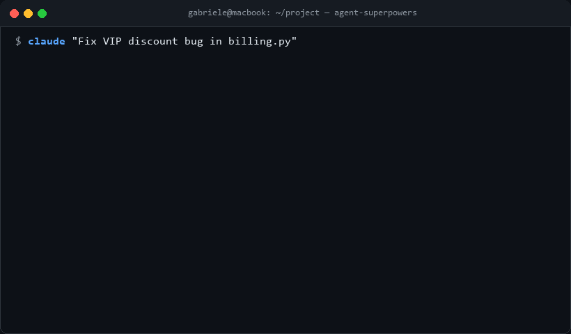

<div align="center">

# ⚡ AGENT SUPERPOWERS
### Transform Your AI Coding Agent into a Battle-Tested Principal Staff Engineer

**Stop AI hallucinations, broken production commits, and 100k-token context bloat.**  
*A disciplined, deterministic 7-stage autonomous engineering framework natively compatible with **Claude Code, Cursor, Google Antigravity, Windsurf, Codex, and Model Context Protocol (MCP)**.*

<br/>

[](https://github.com/GabrieleDattile/agent-superpowers/releases)
[](https://github.com/GabrieleDattile/agent-superpowers/tree/main/skills)
[-10B981?style=for-the-badge&logo=githubactions)](https://github.com/GabrieleDattile/agent-superpowers/blob/main/tests/test_skills.py)
[](https://github.com/GabrieleDattile/agent-superpowers/blob/main/mcp/server.py)
[](https://github.com/GabrieleDattile/agent-superpowers/blob/main/LICENSE)

<br/>

<!-- Hero Terminal Showcase -->
<p align="center">
  
</p>

<!-- Live Execution Breakdown Bar -->
| 🛑 1. Deterministic Repro | 📦 2. Ephemeral Sandbox | 🟢 3. Minimal Surgical Patch | ⚔️ 4. Red-Team Fuzzing | 🚀 5. Production Gate |
| :---: | :---: | :---: | :---: | :---: |
| **`RED Test Required`** | **`Worktree Isolation`** | **`GREEN Verification`** | **`11 Attack Payloads`** | **`Verified Merge`** |
| Zero code edits allowed until bug replicates | Primary branch protected from corrupting edits | Minimal patch turns failing repro green | Null-bytes, SQLi & overflow injection | 100% regression suite verified |

<br/>

> **⭐ Found this useful? Star this repository to empower the open-source autonomous engineering movement!**

</div>

---

## ⚡ Quick Start (Instant 1-Command Setup)

Install the complete 36-skill suite and autonomous Python engines in seconds:

### 🪟 Windows (Native PowerShell)
```powershell
irm https://raw.githubusercontent.com/GabrieleDattile/agent-superpowers/main/install.ps1 | iex
```

### 🐧 macOS / Linux (Native Bash)
```bash
curl -fsSL https://raw.githubusercontent.com/GabrieleDattile/agent-superpowers/main/install.sh | bash
```

### 🔌 Universal MCP Server (Claude Desktop, Cursor, Zed, Antigravity)
Add to your `claude_desktop_config.json` or `.cursor/mcp.json`:
```json
{
  "mcpServers": {
    "agent-superpowers": {
      "command": "python",
      "args": ["mcp/server.py"],
      "cwd": "/path/to/agent-superpowers"
    }
  }
}
```

### 📦 Node.js / NPX
```bash
npx github:GabrieleDattile/agent-superpowers list
```

---

## ⚡ The Difference: Default AI vs. Agent Superpowers

Without guardrails, even state-of-the-art LLMs behave like chaotic junior developers: they jump straight into editing files, hallucinate non-existent APIs, break existing tests, and push unverified changes.

| The Chaos of Default AI ❌ | With Agent Superpowers Protocol 🟢 |
| :--- | :--- |
| **Hallucinates bug fixes**: Edits production code based on guesswork | **Ghost Runner**: Strictly forbidden from editing source code until a minimal failing test reproduces the defect (`RED ➔ GREEN`) |
| **Corrupts your workspace**: Makes sweeping multi-file edits directly on your active working branch | **Git Worktree Sandbox**: Runs all experiments in ephemeral, isolated git worktrees; primary branch remains 100% clean |
| **Generates fragile edge-cases**: Writes happy-path code vulnerable to boundary crashes and exploits | **Adversarial Duelist**: Automated pre-commit red-team fuzzer injects null-bytes, SQLi payloads, and zero-divisions |
| **Produces generic AI slop**: Default purple gradients, formulaic 3-card grids, Inter font, unanchored blur blobs | **Hallmark**: Anti-AI-slop design engine with 24 distinct material themes and automated `sloplint` auditor |
| **Blows token budgets**: Dumps full source files into context, hitting rate limits and burning money | **Token Squeezer**: Shrinks prompt context by 50–70% using AST extraction without losing architectural semantics |
| **Breaks frontend layouts**: Generates UI code that looks fine on desktop but breaks on mobile viewports | **Frontend Sentinel**: WCAG 2.1 accessibility and responsive breakpoint auditor with visual HTML reports |
| **Session amnesia**: Forgets past architectural decisions and conventions every time the CLI restarts | **Memory Nexus**: Append-only local decision ledger (`.superpowers/decisions.jsonl`) persists context cross-session |
| **Locked into closed ecosystems**: Inability to interface with proprietary tools and APIs | **Blackbox Cloner & API Synthesizer**: Clean-room tool replication and automatic cURL-to-SDK synthesis |

---

## 🎬 Live Deep-Dives: See How the Skills Work in Action

### 1. 🔍 Ghost Runner: Strict TDD Bug Reproduction
> **Rule**: An agent is **forbidden from modifying production files** until it writes an isolated test that replicates the bug and fails (`RED`).

```bash
# Run Ghost Runner reproduction gate
python cli/superpowers.py run ghost-runner reproduce --test "python -m unittest tests/test_reproduce.py"
```

```text
=== 👻 Ghost Runner: TDD Reproduction Protocol ===
Test Command: python -m unittest tests/test_reproduce.py
Expected Outcome: FAILURE (RED)

Running test under isolated subshell...
----------------------------------------------------------------------
ZeroDivisionError: division by zero in calculate_discount()
Ran 1 test in 0.002s
FAILED (failures=1)

✔ SUCCESS: Defect reproduced deterministically (Exit Code: 1).
  Agent is now AUTHORIZED to apply minimal surgical patch in worktree.
```

---

### 2. 🛡️ Adversarial Duelist: Pre-Commit Red-Team Fuzzing
> **Rule**: Before any commit or PR is approved, the agent attacks the proposed function with 11 boundary payloads to catch unhandled crashes.

```bash
# Fuzz an authentication or payment function
python cli/superpowers.py run duelist --target services/auth.py --func authenticate_user
```

```text
=== ⚔️ Adversarial Duelist: Red-Team Fuzzer ===
Target: services/auth.py :: authenticate_user()
Testing 11 adversarial injection vectors...

  ✔ [01/11] Null-Byte Poisoning ('admin\x00')      ➔ Handled (ValueError)
  ✔ [02/11] SQL Injection (' OR '1'='1' --)       ➔ Handled (Safe Query)
  ✔ [03/11] Memory Bounding ('A' * 100,000)        ➔ Handled (LengthGuard)
  ✔ [04/11] Zero Divisor (divisor=0)               ➔ Handled (ZeroGuard)
  ✔ [05/11] Float NaN / Infinity (val=float('nan')) ➔ Handled (TypeError)
  ✔ [06/11] Boundary Integer (2^63 - 1)            ➔ Handled (OverflowSafe)
  ...
✔ 11/11 Attack Vectors Defended. Pre-commit authorization granted.
```

---

### 3. 🎨 Hallmark & Sloplint: The Anti-AI-Slop Design Engine
> **Rule**: Prevent LLMs from defaulting to generic AI tropes (purple gradients, predictable 3-card grids, floating blur balls).

```bash
# Audit a landing page or UI component for machine-made design tells
python cli/superpowers.py run sloplint src/components/Hero.tsx
```

```text
=================================================================
🎨 Hallmark Sloplint: Autonomous Anti-AI-Slop Auditor
=================================================================
Scanned: src/components/Hero.tsx

Found 3 aesthetic tells:
  🔴 [SLOP-001] Generic AI Purple Gradient (Line 14)
     Match: 'bg-gradient-to-r from-purple-500 to-indigo-600'
     Fix:   Adopt a deliberate palette from Hallmark themes (e.g. Cobalt, Atelier, Furrow).

  🔴 [SLOP-002] Unanchored Floating Blur Orb (Line 8)
     Match: 'rounded-full blur-3xl bg-purple-500/30'
     Fix:   Replace decorative blobs with real photography, technical diagrams, or clean space.

  🟡 [SLOP-003] AI Buzzword Copy (Line 18)
     Match: 'Supercharge your productivity with AI'
     Fix:   Write concrete, specific value propositions with real numbers and features.

Overall Slop Index: 60 / 100 [FAIL (HIGH SLOP CONTENT)]
Guidance: Apply curated theme tokens from references/themes.json
```

---

### 4. ⚡ Token Squeezer: AST-Based Prompt Compressor
> **Rule**: Shrink massive codebases by **50–70%** before injecting them into prompt context windows, preserving signatures and docstrings.

```bash
# Compress a 500-line service down to its architectural essence
python cli/superpowers.py run squeezer services/payment.py --mode interface
```

```python
# === ORIGINAL (1,420 Tokens) ===              # === SQUEEZED (-68% Tokens) ===
class PaymentGateway:                           class PaymentGateway:
    """Handles Stripe and PayPal charges."""        """Handles Stripe and PayPal charges."""
    def __init__(self, key: str):                   def __init__(self, key: str): ...
        self.key = key                              def charge(self, amount: float,
        self._init_vault()                                     currency: str = "USD") -> bool: ...
        self._connect_webhook()                     def refund(self, txn_id: str) -> bool: ...
    def charge(self, amount: float, ...) -> bool:
        # [80 lines of internal logic]
        ...
```

---

### 5. 🗺️ Arch Archaeologist & Graphify: Codebase Cartography
> **Rule**: Map live module dependencies, trace call trees, and detect dead zombie functions across the entire repository.

```text
flowchart TD
    subgraph Core ["📦 Core Services"]
        AUTH["auth.py<br/><i>authenticate_user()</i>"]
        GATEWAY["gateway.py<br/><i>process_payment()</i>"]
    end
    subgraph Storage ["💾 Storage Layer"]
        DB["database.py<br/><i>query_records()</i>"]
        CACHE["cache.py<br/><i>get_session()</i>"]
    end
    subgraph DeadCode ["⚠️ Dead Zombie Code (Isolated)"]
        LEGACY["legacy_v1_api.py<br/><i>[0 references detected]</i>"]
    end

    AUTH --> DB
    AUTH --> CACHE
    GATEWAY --> DB
    style LEGACY stroke:#ef4444,stroke-dasharray: 5 5,color:#ef4444
```

---

## 🔄 The 7-Stage Autonomous Lifecycle

Every coding task executes through an auditable, deterministic state machine:

```text
┌─────────────────┐       ┌─────────────────┐       ┌─────────────────┐
│ 1. BRAINSTORM   │ ────> │ 2. WORKTREE     │ ────> │ 3. MAP &        │
│ Requirements    │       │ Sandbox Branch  │       │ Compress (AST)  │
└─────────────────┘       └─────────────────┘       └─────────────────┘
                                                              │
                                                              ▼
┌─────────────────┐       ┌─────────────────┐       ┌─────────────────┐
│ 6. RED-TEAM     │ <──── │ 5. SURGICAL     │ <──── │ 4. TDD PROOF    │
│ Fuzzing & Audit │       │ Green Patch     │       │ Fail First (RED)│
└─────────────────┘       └─────────────────┘       └─────────────────┘
        │
        ▼
┌─────────────────┐
│ 7. SAFE MERGE   │ ────> Verified Production-Ready Artifact
│ & PR Gate       │
└─────────────────┘
```

---

## 📦 Complete Autonomous Superpowers Suite (36 Skills)

<details open>
<summary><b>🧠 Core Orchestration & Lifecycle (3 Skills)</b></summary>

| Superpower | Category | Primary Capability |
| :--- | :--- | :--- |
| [**`using-superpowers`**](skills/orchestration/using-superpowers/SKILL.md) | 🧠 Orchestration | Master bootstrap meta-skill; enforces the 7-stage engineering lifecycle |
| [**`feature-brainstormer`**](skills/workflow/feature-brainstormer/SKILL.md) | 💡 Workflow | Socratic requirements refiner; asks 3 clarifying questions before writing code |
| [**`git-worktree-sandbox`**](skills/workflow/git-worktree-sandbox/SKILL.md) | 📦 Workflow | Ephemeral git worktree isolation; zero risk of corrupting your active workspace |

</details>

<details open>
<summary><b>🔍 Debugging & Verification (3 Skills)</b></summary>

| Superpower | Category | Primary Capability |
| :--- | :--- | :--- |
| [**`ghost-runner`**](skills/debugging/ghost-runner/SKILL.md) | 🔍 Debugging | Zero-assumption bug reproducer; enforces strict RED ➔ GREEN TDD cycle |
| [**`testsprite-verify`**](skills/testing/testsprite-verify/SKILL.md) | 🧪 Testing | Closed-loop automated regression and user flow verification |
| [**`testsprite-ci`**](skills/testing/testsprite-ci/SKILL.md) | 🧪 Testing | CI pipeline test automation and test suite orchestration |

</details>

<details open>
<summary><b>🛡️ Security & Reverse Engineering (3 Skills)</b></summary>

| Superpower | Category | Primary Capability |
| :--- | :--- | :--- |
| [**`adversarial-duelist`**](skills/security/adversarial-duelist/SKILL.md) | 🛡️ Security | Pre-commit red-team fuzzer; injects malicious edge-case payloads |
| [**`blackbox-cloner`**](skills/reverse-engineering/blackbox-cloner/SKILL.md) | 🕵️ Reverse Engineering | Clean-room tool replicator; deconstructs proprietary software into open-source scaffolds |
| [**`api-synthesizer`**](skills/reverse-engineering/api-synthesizer/SKILL.md) | 🔌 Integration | Network-to-SDK generator; converts cURL traffic into typed Python client SDKs |

</details>

<details open>
<summary><b>🗺️ Architecture & Memory (5 Skills)</b></summary>

| Superpower | Category | Primary Capability |
| :--- | :--- | :--- |
| [**`arch-archaeologist`**](skills/architecture/arch-archaeologist/SKILL.md) | 🗺️ Architecture | Codebase cartographer; traces dependency graphs and isolates dead zombie functions |
| [**`graphify`**](skills/architecture/graphify/SKILL.md) | 🗺️ Architecture | AST-driven persistent knowledge graph of codebases, schemas, and docs without vector DB |
| [**`hindsight-architect`**](skills/architecture/hindsight-architect/SKILL.md) | 🗺️ Architecture | Memory architect for application design patterns and decisions |
| [**`memory-nexus`**](skills/memory/memory-nexus/SKILL.md) | 💾 Memory | Cross-session architecture ledger; eliminates agent amnesia between restarts |
| [**`hindsight-memory`**](skills/memory/hindsight-memory/SKILL.md) | 💾 Memory | Adaptive long-term project memory and automatic session synthesis |

</details>

<details open>
<summary><b>⚡ Optimization & Token Efficiency (4 Skills)</b></summary>

| Superpower | Category | Primary Capability |
| :--- | :--- | :--- |
| [**`token-squeezer`**](skills/optimization/token-squeezer/SKILL.md) | ⚡ Optimization | AST-based context compressor; cuts LLM prompt token costs by 50–70% |
| [**`caveman`**](skills/optimization/caveman/SKILL.md) | ⚡ Optimization | Terse smart-caveman voice; eliminates fluff while preserving all technical facts |
| [**`caveman-compress`**](skills/optimization/caveman-compress/SKILL.md) | ⚡ Optimization | Extreme token compression for memory files and long context |
| [**`prompt-optimizer`**](skills/optimization/prompt-optimizer/SKILL.md) | ⚡ Optimization | Systematic prompt evaluation, few-shot generation, and constraint tuning |

</details>

<details open>
<summary><b>🎨 Frontend, Design & Anti-Slop (5 Skills)</b></summary>

| Superpower | Category | Primary Capability |
| :--- | :--- | :--- |
| [**`hallmark`**](skills/frontend/hallmark/SKILL.md) | 🎨 Frontend | Anti-AI-slop design engine; overrides generic purple gradients with 24 material themes & sloplint |
| [**`frontend-sentinel`**](skills/frontend/frontend-sentinel/SKILL.md) | 🎨 Frontend | Production UI/UX auditor; checks a11y, mobile viewports & generates visual HTML reports |
| [**`figma-designer`**](skills/frontend/figma-designer/SKILL.md) | 🎨 Frontend | Token-driven Figma design specs, components, auto-layout, and design systems |
| [**`landing-page-design`**](skills/frontend/landing-page-design/SKILL.md) | 🎨 Frontend | High-converting landing page blueprints, copywriting, and visual structure |
| [**`review-frontend-production`**](skills/frontend/review-frontend-production/SKILL.md) | 🎨 Frontend | Production frontend inspection, compliance checks, and handover verification |

</details>

<details open>
<summary><b>🕸️ Web Data, Scraping & Social (7 Skills)</b></summary>

| Superpower | Category | Primary Capability |
| :--- | :--- | :--- |
| [**`scrapling`**](skills/scraping/scrapling/SKILL.md) | 🕸️ Scraping | Adaptive web scraping framework with anti-bot bypass and stealth browser sessions |
| [**`firecrawl-build`**](skills/scraping/firecrawl-build/SKILL.md) | 🕸️ Scraping | In-app Firecrawl integration for live web data, extraction, and search |
| [**`firecrawl-scrape`**](skills/scraping/firecrawl-scrape/SKILL.md) | 🕸️ Scraping | Single-page extraction into structured markdown |
| [**`firecrawl-search`**](skills/scraping/firecrawl-search/SKILL.md) | 🕸️ Scraping | Agent web discovery before extraction |
| [**`firecrawl-interact`**](skills/scraping/firecrawl-interact/SKILL.md) | 🕸️ Scraping | Post-scrape browser actions, form filling, and pagination |
| [**`firecrawl-onboard`**](skills/scraping/firecrawl-onboard/SKILL.md) | 🕸️ Scraping | Firecrawl SDK credentials, auth flows, and project onboarding |
| [**`agent-reach`**](skills/scraping/agent-reach/SKILL.md) | 🕸️ Scraping | Zero-API reading and search across public web sources, video transcripts, and developer platforms |

</details>

<details open>
<summary><b>📐 Lean Engineering & Multimedia (6 Skills)</b></summary>

| Superpower | Category | Primary Capability |
| :--- | :--- | :--- |
| [**`ponytail`**](skills/workflow/ponytail/SKILL.md) | 📐 Workflow | YAGNI principal engineer mindset; smallest change that fully solves the task |
| [**`ponytail-audit`**](skills/workflow/ponytail-audit/SKILL.md) | 📐 Workflow | Whole-repo bloat and unnecessary dependency audit |
| [**`ponytail-debt`**](skills/workflow/ponytail-debt/SKILL.md) | 📐 Workflow | Technical debt and shortcut tracking ledger |
| [**`ponytail-review`**](skills/workflow/ponytail-review/SKILL.md) | 📐 Workflow | Pull request quality and anti-overengineering reviewer |
| [**`caveman-commit`**](skills/workflow/caveman-commit/SKILL.md) | 📐 Workflow | Intent-only Conventional Commits generator |
| [**`video-shotcraft`**](skills/multimedia/video-shotcraft/SKILL.md) | 🎬 Multimedia | Programmatic Remotion cinematic product video synthesis |

</details>

---

## 🛠️ Universal Platform Support

Agent Superpowers is completely runtime-agnostic. Drop it into your existing workflow with zero configuration:

* **🟣 Claude Code**: Native plugin manifest in [`.claude-plugin/plugin.json`](.claude-plugin/plugin.json) with startup lifecycle hooks in [`hooks/`](hooks/).
* **🔵 Cursor**: Modern `.mdc` Project Rules in [`.cursor/rules/agent-superpowers.mdc`](.cursor/rules/agent-superpowers.mdc).
* **🟠 Google Antigravity & Gemini CLI**: Native workspace extension in [`extension.yaml`](extension.yaml).
* **🌊 Windsurf**: Native IDE rules in [`.windsurfrules`](.windsurfrules).
* **🟢 OpenAI Codex**: Configured via [`.codex/INSTALL.md`](.codex/INSTALL.md).
* **🔌 Model Context Protocol (MCP)**: Native stdio JSON-RPC server in [`mcp/server.py`](mcp/server.py). Compatible with Claude Desktop, Cursor, Antigravity, and Zed.

---

## 📊 Mission Control Dashboard

Agent Superpowers ships with an interactive local web dashboard with **zero external dependencies**. Visualize your skills, architecture dependency graphs, and test telemetry in real time:

```bash
python cli/superpowers.py dashboard
```

---

## 🚀 CLI Commands & Validation

Agent Superpowers includes a built-in verification suite:

```bash
# List all 36 registered superpowers
python cli/superpowers.py list

# Run system health check across all engines
python cli/superpowers.py status

# Validate specification compliance
python cli/superpowers.py validate

# Run the automated unit test suite
python -m unittest tests/test_skills.py
```

---

## 🤝 Contributing

Contributions are warmly welcomed!
1. Check our formal [Agent Skill Specification](docs/SPECIFICATION.md).
2. Propose new skills via the [New Skill Template](.github/ISSUE_TEMPLATE/new_skill.yml).
3. Ensure CI verification passes (`python cli/superpowers.py validate`).

---

## 👤 Author

**Gabriele D'Attile**  
* Portfolio & Technical Dossier: [https://gabrieledattile.github.io/agent-superpowers.html](https://gabrieledattile.github.io/agent-superpowers.html)  
* Website: [https://gabrieledattile.github.io](https://gabrieledattile.github.io)  
* GitHub: [@GabrieleDattile](https://github.com/GabrieleDattile)  
* Repository: [https://github.com/GabrieleDattile/agent-superpowers](https://github.com/GabrieleDattile/agent-superpowers)

---

## 📄 License

This project is licensed under the [MIT License](https://github.com/GabrieleDattile/agent-superpowers/blob/main/LICENSE).
