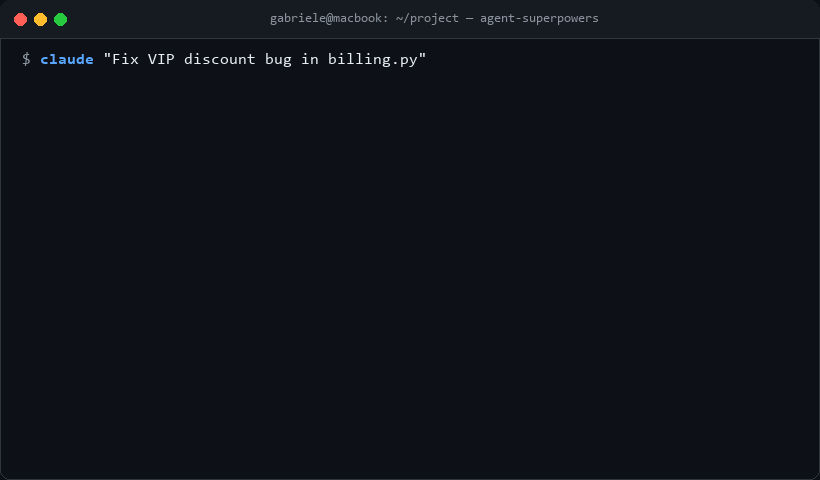

<div align="center">

# ⚡ Agent Superpowers

**The universal, production-grade skills framework for autonomous AI software engineers.**  
*Plug-and-play compatibility across Claude Code, Cursor, Codex, Antigravity, Windsurf, Gemini CLI, and Model Context Protocol (MCP).*

[](https://github.com/GabrieleDattile/agent-superpowers)
[](LICENSE)
[](docs/SPECIFICATION.md)
[](mcp/server.py)
[](https://github.com/GabrieleDattile)

<br/>



<br/>
<br/>

</div>

---

## 💡 Why Agent Superpowers?

Most AI coding assistants (like default Cursor or Claude sessions) act like chaotic junior developers: they **guess fixes, edit production files prematurely, blow through token limits, and introduce silent regressions**.

**Agent Superpowers** equips your AI agent with a disciplined **7-Stage Autonomous Engineering Lifecycle**:

```text
[1. BRAINSTORM] ──> [2. WORKTREE ISOLATE] ──> [3. MAP & COMPRESS]
       │                                              │
       ▼                                              ▼
[7. MERGE / PR] <── [6. RED-TEAM FUZZ] <── [5. SURGICAL PATCH] <── [4. TDD PROOF (RED)]
```

* 🧠 **Master Orchestration**: Automatically chains skills from brainstorming to isolated execution.
* 📦 **Zero-Risk Worktrees**: Ephemeral git worktrees guarantee your primary branch is never corrupted during agent experiments.
* 🔬 **Scientific TDD**: Prohibits editing source code until a minimal failing test reproduces the bug in isolation (`RED`).
* ⚔️ **Offensive Red-Teaming**: Attacks functions with null-bytes, SQLi vectors, and boundary overflows before allowing a merge.
* 📉 **60% Token Reduction**: AST interface compressor slashes LLM API costs while retaining 100% semantic clarity.
* 🔌 **Zero-Friction SDKs**: Transforms raw cURL network traffic and browser HAR dumps into typed client libraries in seconds.
* 🗺️ **Code Cartography**: Automatically diagrams spaghetti code dependencies and detects dead zombie functions.

---

## 📦 The 8 Superpowers

| Skill | Category | Primary Capability |
| :--- | :--- | :--- |
| [**`using-superpowers`**](skills/orchestration/using-superpowers/SKILL.md) | 🧠 Orchestration | Master bootstrap meta-skill; enforces the 7-stage engineering lifecycle |
| [**`feature-brainstormer`**](skills/workflow/feature-brainstormer/SKILL.md) | 💡 Workflow | Socratic requirements refiner; asks 3 clarifying questions before coding |
| [**`git-worktree-sandbox`**](skills/workflow/git-worktree-sandbox/SKILL.md) | 📦 Workflow | Ephemeral git worktree isolation; zero risk of breaking active workspace |
| [**`ghost-runner`**](skills/debugging/ghost-runner/SKILL.md) | 🔍 Debugging | Zero-assumption bug reproducer; enforces strict RED ➔ GREEN TDD cycle |
| [**`adversarial-duelist`**](skills/security/adversarial-duelist/SKILL.md) | 🛡️ Security | Pre-commit red-team fuzzer; injects malicious edge-case payloads |
| [**`token-squeezer`**](skills/optimization/token-squeezer/SKILL.md) | ⚡ Optimization | AST-based context compressor; cuts LLM prompt token costs by 50-70% |
| [**`api-synthesizer`**](skills/reverse-engineering/api-synthesizer/SKILL.md) | 🔌 Integration | Network-to-SDK generator; converts cURL traffic into typed Python clients |
| [**`arch-archaeologist`**](skills/architecture/arch-archaeologist/SKILL.md) | 🗺️ Architecture | Codebase cartographer; traces dependency graphs and isolates dead code |

---

## ⚡ 1-Click Universal Installation

Agent Superpowers runs everywhere. Install all skills across your tools with a single command:

```bash
git clone https://github.com/GabrieleDattile/agent-superpowers.git
cd agent-superpowers
python install.py --target all
```

Or deploy to a specific environment:

### 🟣 Claude Code (Native Plugin)
Claude Code automatically recognizes the included `.claude-plugin/plugin.json`:
```bash
python install.py --target claude
```

### 🔵 Cursor
Injects native MDC rules into your workspace `.cursor/rules/`:
```bash
python install.py --target cursor
```

### 🟠 Google Antigravity & Gemini CLI
Installs directly into `.gemini/antigravity/skills` or via extension manifest:
```bash
python install.py --target antigravity
```

### 🟢 OpenAI Codex
Configures `.codex/` with automatic skill indexing:
```bash
python install.py --target codex
```

### 🔌 Model Context Protocol (MCP) Server
Plug Agent Superpowers into **Claude Desktop, Cursor, Zed, or OpenCode** via stdio JSON-RPC:
```json
{
  "mcpServers": {
    "agent-superpowers": {
      "command": "python",
      "args": ["-m", "mcp.server"]
    }
  }
}
```

---

## 🚀 Quick CLI Verification

Inspect registered skills and run automated CI checks locally:
```bash
# List all 8 registered superpowers
python cli/superpowers.py list

# Validate specification compliance
python cli/superpowers.py validate

# Run the automated unit test suite
python -m unittest tests/test_skills.py
```

---

## 🤝 Contributing & Specification

Want to add a new superpower?
1. Follow our formal [Agent Skill Specification](docs/SPECIFICATION.md).
2. Submit a proposal using the [New Skill Template](.github/ISSUE_TEMPLATE/new_skill.yml).
3. Ensure CI checks pass (`python cli/superpowers.py validate`).

---

## 👤 Author

**Gabriele Dattile**  
* GitHub: [@GabrieleDattile](https://github.com/GabrieleDattile)

---

## 📄 License

This project is licensed under the [MIT License](LICENSE).
